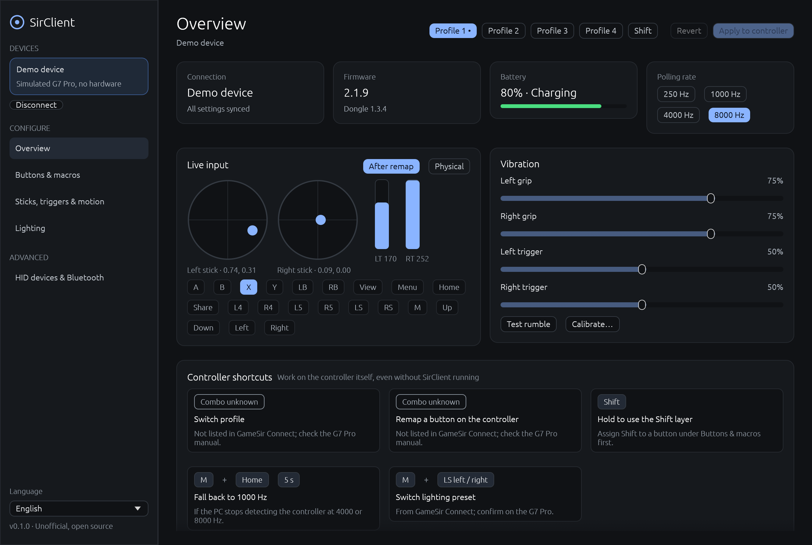

# SirClient

[](https://github.com/Asion001/SirClient/actions/workflows/ci.yml)

An open-source, cross-platform configurator for GameSir controllers,
written in Rust. It is an alternative to the Windows-only GameSir Connect
app and runs on Windows, macOS and Linux.

> **Unofficial.** SirClient is not affiliated with or endorsed by GameSir.
> The protocol was worked out from the official app for interoperability.
> No GameSir firmware, images or other assets are included.



## Status

| Controller | Status |
|---|---|
| G7 Pro 8K (G7 Pro CE), wired and 2.4 GHz dongle | Supported |
| Cyclone 2, K2 8K, Tarantula CE, Tegenaria Lite | Detected, protocol not ported yet |
| Nova Pro, Nova 2 Lite, Nova Vision, Tarantula Pro, T3XS | Detected, needs research (official app uses closed DLLs) |

Full list: [docs/devices.md](docs/devices.md).

The G7 Pro support has been developed against the official app's code and a
simulated controller, and **still needs testing on real hardware**. Reports
are welcome.

## Features (G7 Pro 8K)

- Four profiles plus the Shift layer; switch the active profile.
- Remap every button, including LT/RT and the L4/R4/L5/R5 back buttons, to
  controller buttons, keyboard keys or mouse buttons; up to three at once.
- Turbo (0–30 Hz) and toggle per button.
- Macros on the back buttons: up to 32 steps with hold and delay times,
  repeat, and trigger-on-press.
- Sticks: inner/outer/anti dead zones, response curves (linear, relaxed,
  aggressive, or custom with draggable points), anti-jitter, square output,
  output as left stick, right stick, four keys or mouse, and invert X/Y.
- Triggers: dead zones, curves and hair trigger.
- Gyro aim and tilt: activation mode, trigger button, axis, sensitivity and
  output.
- Vibration strength for all four motors, plus a rumble test.
- Polling rate (250 Hz to 8 kHz).
- Lighting: five presets, six effects, per-zone colours, brightness, speed
  and standby.
- Live input view (after remapping or physical), battery and firmware
  version.
- Stick and trigger calibration.
- **Demo device** for trying the app without a controller.
- **HID devices & Bluetooth** page listing every HID collection and its bus.
  It can probe a collection to check whether the controller accepts
  configuration over that connection (GameSir Connect has no Bluetooth
  support).
- Localized UI using [Fluent](docs/TRANSLATING.md).

Changes stay local until you press **Apply to controller**. Only the changed
bytes are written, the same way the official app does it.

## Download

- **Test builds:** every push to `main` builds Linux (x86_64, arm64),
  Windows (x86_64, arm64) and macOS (universal) packages. Open the latest
  [CI run](https://github.com/Asion001/SirClient/actions/workflows/ci.yml)
  and download them from its **Artifacts** section (you need to be signed in
  to GitHub).
- **Releases:** pushing a `v*` tag publishes the same packages on the
  [Releases](https://github.com/Asion001/SirClient/releases) page.

The macOS app is ad-hoc signed but not notarized. On first launch,
right-click it and choose **Open**. On Linux, also install the udev rule
(below).

## Build from source

You need Rust 1.95 or newer ([rustup.rs](https://rustup.rs)).

```bash
cargo run --release -p sirclient-gui
```

Without a controller:

```bash
cargo run --release -p sirclient-gui -- --mock
```

### Linux

Install the hidapi build dependency, then allow your user to open the
controller:

```bash
sudo apt install libudev-dev pkg-config
```

```bash
sudo cp packaging/linux/70-sirclient.rules /etc/udev/rules.d/ && sudo udevadm control --reload-rules && sudo udevadm trigger
```

### macOS

Nothing extra for the controller's configuration interface. The probe
page may need Input Monitoring permission to read keyboard or mouse
collections.

## Project layout

```
crates/
  sirclient-core/   protocol, device registry, HID transport, session engine, mock device
  sirclient-gui/    egui desktop app (binary: sirclient), locales/*.ftl
docs/
  protocol/g7-pro.md   wire protocol and profile layout
  devices.md           every model GameSir Connect knows, with IDs and status
  TRANSLATING.md       how to add a language
packaging/linux/       udev rules
```

## Development

```bash
cargo test --workspace
```

The core tests cover profile encoding round trips and the full
load → edit → write → reload cycle against the simulated controller. To
regenerate the screenshots, run:

```bash
cargo run -p sirclient-gui -- --screenshot docs/screenshots
```

## License

Licensed under either of [Apache License 2.0](LICENSE-APACHE) or
[MIT](LICENSE-MIT), at your option.
